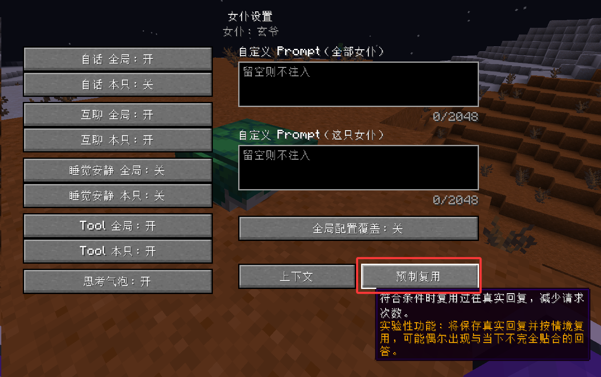
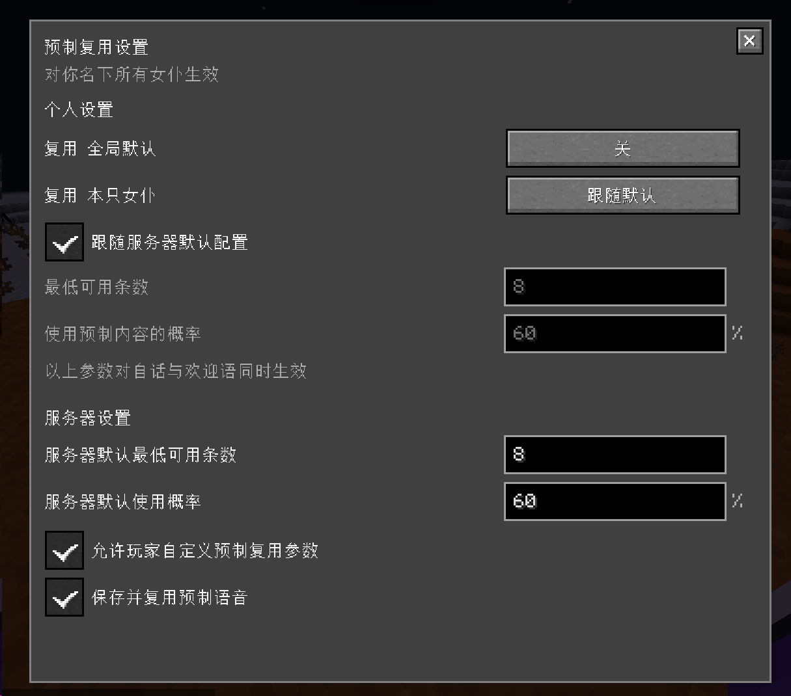
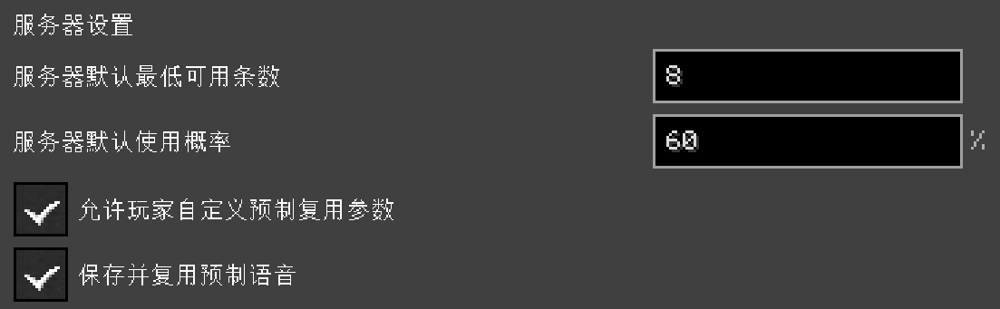
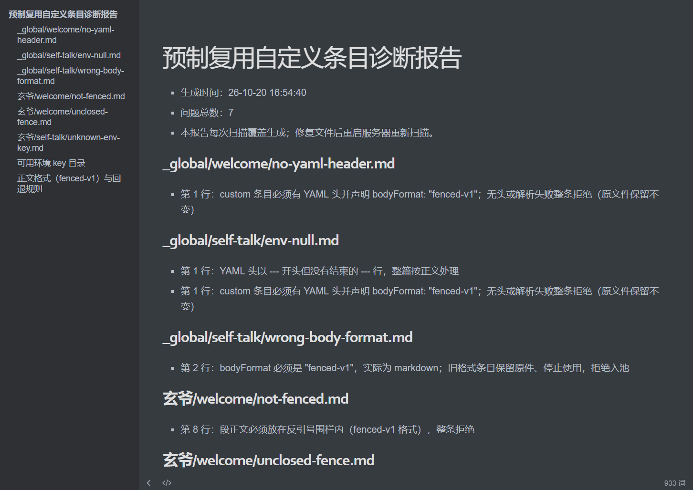
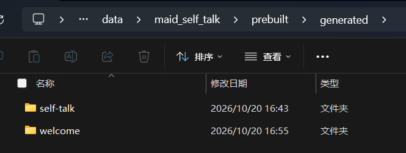
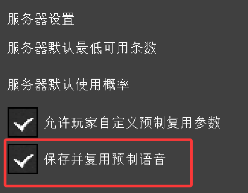
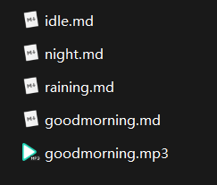

# Custom Prebuilt Self-Talk / Welcome Message Guide

> Last updated October 30, 2026, for mod version 1.4.1. Please keep in mind that this information may become outdated.
>
> This guide is intended for players and server administrators. It introduces the "prebuilt self-talk / welcome message reuse" feature added in TLM Self-Talk 1.4.0.
>
> If you only want to learn how to use custom prebuilt content, you can skip the first half and go directly to [Custom Prebuilt Content](#custom-prebuilt-content) and [Prebuilt Audio Cache (Optional)](#prebuilt-audio-cache-optional).
>
> **For non-Chinese-speaking players:** Sorry, due to limited time and resources, I haven't been able to provide English screenshots of the UI yet. I'll try to add them as soon as possible. In the meantime, please refer to the Chinese screenshots for guidance. Thank you for your understanding!

## Table of Contents

- [Background and Design](#background-and-design)
- [Quick Start](#quick-start)
- [How Environment Matching Works](#how-environment-matching-works)
- [Player Settings](#player-settings)
- [Administrator Settings](#administrator-settings)
- [Custom Prebuilt Content](#custom-prebuilt-content)
  - [Directory Location](#directory-location)
  - [Entry File Format](#entry-file-format)
  - [Complete Examples](#complete-examples)
  - [How to Write env Conditions](#how-to-write-env-conditions)
  - [What to Do If the Format Is Invalid](#what-to-do-if-the-format-is-invalid)
- [Automatically Generated Entries](#automatically-generated-entries)
- [Prebuilt Audio Cache (Optional)](#prebuilt-audio-cache-optional)
  - [Automatic Cache](#automatic-cache)
  - [Manual Audio Files](#manual-audio-files)
- [FAQ](#faq)

---

## Background and Design

> By default, every AI self-talk line and owner-login welcome message added by this mod is generated by calling the AI in real time, which creates a real API request. In practice, however, you will find that self-talk and welcome messages in similar situations often do not differ very much. This mod therefore adds an optional "prebuilt reuse" feature. It allows maids to store self-talk and welcome messages that have already been generated, and when enough entries are available and the environmental conditions overlap, it can reuse a previously generated message and reduce the cost of API requests.
>
> This feature also provides a way to use custom content. Players can write their own self-talk and welcome messages for maids to create a more consistent conversational experience.

When "prebuilt reuse" is enabled:

- When a maid **generates a self-talk line or welcome message through a real AI call**, the mod **automatically stores that message in the world's content library**, together with core information such as the environmental conditions at the time, the maid's persona, and the language.
- Later, when a self-talk or welcome trigger occurs in a **sufficiently similar environment**, the mod first searches the content library for matching entries based on environmental conditions and other factors. If enough matching entries are available, it uses an existing message directly, **skipping that AI generation**, which makes the response faster and saves an API call.
- To avoid repeating the same limited set of messages forever, the mod still makes a real API call for 40% of requests by default when enough matching entries are available, keeping the content library supplied with new material.
- You can also **write your own entries** and place them in the `custom/` directory, so a maid can say lines you have written for specific situations, such as fixed holiday greetings, complaints about particular weather, server-specific jokes, and so on. See below for the hand-written entry format.

This feature currently **only applies to self-talk and login welcome messages**. Normal chats between players and maids, as well as inter-maid chats, do not use prebuilt content. The feature is disabled by default and must be enabled manually.

## Quick Start

1. **Open the maid settings screen**: In TLM's AI chat screen, click the small "💬" button at the end of the button group on the left to open the "Maid Settings" page.
2. **Open the reuse panel**: On the settings page, click the "Prebuilt Reuse" button below the Prompt panel on the right to open the reuse settings overlay.



3. **Choose the scope**: In the overlay, enable "Reuse Global Default" (applies to all maids you own), or set a single maid to "Force On".

## How Environment Matching Works

> The mod compares "who this maid is (name + persona)" and "what the current environment is (weather, time, events, and so on)" against existing entries in the prebuilt content library. Entries whose conditions match enter the random pool, and when a prebuilt message is delivered, it is drawn from that random pool.

- **Separated by persona**: The same maid (same name + same persona) shares one content library. Changing the persona or the maid's name creates a new content library. The old library remains in the save file but no longer participates in matching unless a new maid appears whose name and persona exactly match those recorded for that library.
- **Exact matching within each entry**: For example, if an entry's `time` environment variable records "night", then when a trigger occurs during "day", that variable is considered unmatched for this entry.
- **Selective matching across conditions**: When an entry records several environmental variables and other conditions, the entry is considered a match as long as it exactly matches **at least 4 conditions**.

## Player Settings

The reuse settings panel is divided into two sections, one above the other:



"Personal Settings" section (visible to everyone):

- **Reuse Global Default**: The player's own master switch, disabled by default. Once enabled, all maids owned by that player that have not been configured individually will use prebuilt reuse.
- **Reuse This Maid**: Each maid can be set individually to "Follow Default / Force On / Force Off".

After an administrator allows personal parameter settings, two number fields and a "Follow server defaults" checkbox will also appear here:

- **Follow server defaults**: When checked, the server's global parameters are used.
- **Minimum eligible entries**: If the number of eligible candidates is below this value, prebuilt content is not reused and a real generation request is made.
- **Reuse chance**: When enough candidates are available, this chance determines whether prebuilt content is reused. If the chance roll fails, normal real generation is used.

If an administrator disables player options in the configuration, the player's previously saved parameters are not deleted, but they no longer take effect.

## Administrator Settings

The "Server Settings" section is only visible to administrators (OP ≥ 2). It allows you to adjust:



- **Server minimum eligible entries** (default: 8):
  Prebuilt content can only be used when the number of candidate entries in the current environment reaches this value.
  Lower → prebuilt content is easier to trigger;
  Higher → prebuilt content is more likely to be used only when a particular environment lasts long enough.

- **Server reuse chance** (default: 60%):
  Lower → prebuilt content is easier to trigger;
  Higher → real AI generation is preferred.

- **Allow players to customize reuse parameters**: Whether players may override the two values above. When disabled, everyone's "Follow server defaults" state is reset. Personal parameter values are retained, but players must manually turn off following again after the option is re-enabled.

There are also two **configuration file** options in the `prebuilt_reuse` section of `config/maid_self_talk-common.toml`. They are not available in the in-game administrator interface and can only be changed by editing the configuration file. They are intended for advanced use cases and normally do not need to be changed:

| Option | Default | Purpose |
| --- | --- | --- |
| `minMatchingContexts` | 4 | The minimum number of environmental conditions that must exactly match the current environment before an entry is considered a candidate |
| `maxEntriesPerSource` | 300 | The capacity limit for each source (welcome / self-talk) in each maid's content library. When exceeded, the oldest machine-generated entries are evicted (custom entries are not counted against this limit) |

## Custom Prebuilt Content

This is the most playful part of the feature: **a hand-written custom dialogue library**. It is also the main focus of this guide.

### Directory Location

Files created by this feature are stored inside the world save. The file layout is as follows:

> Anything under `<world save>/data/maid_self_talk/prebuilt/` with a `generated` prefix is machine-generated content. Do not edit it casually.
>
> The folder intended for user customization is `<world save>/data/maid_self_talk/prebuilt/custom/`.

```
<world save>/data/maid_self_talk/prebuilt/custom/    ← note that this is custom/
├── _global/                    ← applies to all maids
│   ├── welcome/                ← welcome messages (on login)
│   │   └── *.md
│   └── self-talk/              ← self-talk
│       └── *.md
└── <maid display name>/        ← applies only to this maid (use the name shown in game, including a name tag if one is used)
    ├── welcome/
    │   └── *.md
    └── self-talk/
        └── *.md
```

Please note:

- This mod only uses `.md` files at the **top level** of the `welcome/` and `self-talk/` directories. Files in subdirectories are ignored.
- Directories whose names start with `_` (such as `_global`) are reserved names. **Do not use such a name as a maid's name.**
- **How `_global/` works**: prebuilt content inside the `_global/` folder applies to all maids.
- `_diagnostics.md` is a diagnostics report generated automatically by the mod. **It warns users about format errors and other problems in custom content. Treat it as read-only; manual edits have no effect.**
- **Format warnings for the `_global/` directory are never sent as in-game private messages to anyone.** They are only written to the diagnostics report.
- If a folder named after a maid **does not match any loaded maid**, it is listed in the `_diagnostics.md` diagnostics report, which helps catch misspelled names.
- Maid-name folders resolve names in the order "name tag name → built-in model preset name".
- When using a custom YSM model, **if the maid has no name tag name**, the maid's name in the chat box is displayed as the model name. **That name is not treated as the maid's name and cannot be resolved.** Therefore, such maids can only use prebuilt content under `_global/` until they have a name tag name.
- **Restart the server for changes or newly added files to take effect.** The `custom/` folder is read-only to the mod: the mod never modifies, deletes, or writes content into these files. It only creates `_diagnostics.md` as a diagnostics report.
- Make sure that your maid's name and the folder name containing its prebuilt content are **character-for-character identical**; otherwise they cannot be matched.

### Entry File Format

All file formats described in this section use Markdown.

Each `.md` file is one prebuilt entry. It consists of two parts: a **YAML header** (between `---` lines, describing environmental context and other matching conditions) and a **body** (the content the maid actually says).

**Required format** (an entry that does not meet these requirements is invalid, will not be enabled normally, and will be written to the diagnostics report):

1. It must have a YAML header (beginning and ending with `---`).
2. The YAML header must declare `bodyFormat: "fenced-v1"`.
3. It must contain at least the H2 heading `Chat`, and the body must be wrapped in a Markdown fenced code block.

A minimal working example: [minimal-example.md](attachment/minimal-example.md)

The body must be placed in the `## Chat` and `## TTS` sections, with each section wrapped in a pair of triple-backtick Markdown code fences:

- `## Chat`: The text displayed in the chat bar or speech bubble (required).
- `## TTS`: The text read by text-to-speech synthesis (optional; if omitted, the mod uses or translates the Chat text for one TTS request to generate audio).

No other stray text is allowed outside the code blocks.

### Complete Examples

A "rainy-day self-talk" entry that applies to all maids on the server, placed at `custom/_global/self-talk/rainy-day.md`:

[rainy-day.md](attachment/rainy-day.md)

A "morning welcome message" that only applies to your maid "Xiaoling" and only in Chinese environments, placed at `custom/小铃/welcome/good-morning.md`:

[good-morning.md](attachment/good-morning.md)

> Note: The env key names and values above (`weather`, `game_time`, and so on) are **example values**. The actual available environment keys are those listed in the "environment key catalog" at the end of the `custom/_diagnostics.md` report generated by your server.

### How to Write env Conditions

- For each key inside a single `env` block, all values must match the actual environment when the trigger occurs;
- **No environmental constraints / generic entries**: Omitting `env` or writing `env: {}` means the entry can match **any environment**;
- If `chatLanguage` is not written in the YAML header, the entry is language-agnostic (any language may be used). If it is written, it must match the language used by the player when the trigger occurs;
- If an env key or value is written in an invalid form (for example, an explicit empty value, a list, or a nested structure), the entry is rejected or skipped, and the diagnostics report explains why.

### What to Do If the Format Is Invalid

- If the mod reads an entry with a format problem, it skips it and leaves the original file unchanged. Repair it according to the instructions and examples in the report, then restart the game to restore it.
- All entries with errors are recorded in `custom/_diagnostics.md`, where you can review, check, and fix them.



- If a named maid directory contains errors, that maid's owner receives a private message the **first time they log in during this game/server session**, reminding them to address the issues promptly.


## Automatically Generated Entries

Once reuse is enabled, after every successful real generation (and while the reuse switch is still enabled at that time), the mod automatically stores the new content as a machine-generated entry:

```
<world save>/data/maid_self_talk/prebuilt/generated/
├── welcome/v1-<persona fingerprint>/entry-<UUID>.md
└── self-talk/v1-<persona fingerprint>/entry-<UUID>.md
```

Machine-generated entries also use the YAML header + body format, with somewhat stricter validation. They record all environmental conditions selected at the time, as well as the language, persona, and creation time. **You may open them to inspect their contents, but manual editing is not recommended**—they are a content library managed by the mod. If you want to write your own content, use `custom/`.

Capacity management:

- Each maid and each type are counted separately. The default limit is 300 entries.
- When the number of entries reaches the limit, the **oldest** machine-generated entries are evicted automatically.
- Hand-written `custom/` entries are not counted against the limit and are not deleted automatically.



## Prebuilt Audio Cache (Optional)

### Automatic Cache

By default, even when a prebuilt entry is matched, its TTS audio is still synthesized through the synthesis API in real time. An **administrator** can enable prebuilt audio caching by turning on **"Save & reuse prebuilt voice lines"** in the in-game settings panel (disabled by default):

- Once enabled, real synthesized audio is automatically separated and cached in `prebuilt/generated-audio/` by "voice + language".
- The next time the same entry is matched, and the current voice and language are the same, the **cached audio is played directly**.
- Turning the switch off only stops new caching and cached playback. **It does not delete existing audio files.**



### Manual Audio Files

You can also provide **custom voice recordings** for `custom` entries:

- Place the audio file in the **same directory** as the `.md` entry file and give it the **same base name**, changing only the file extension.
  For example, the valid prebuilt audio file name for `good-morning.md` is `good-morning.mp3`.
- Manual audio **does not check whether the language matches** by default and is used directly with the highest priority.
- If both `.mp3` and `.ogg` files exist, MP3 is preferred.
- Currently, only MP3, Ogg Opus, and Ogg Vorbis are supported.



## FAQ

**Q: Once prebuilt content is enabled, will maids stop saying anything new?**<br>
A: No. The number of candidates must reach the "minimum eligible entries" threshold and then pass the "reuse chance" roll. With the default 60% chance, 40% of triggers still generate new content in real time (and continue enriching the library). Set the chance to 100% only if you want to reuse old content as much as possible.

**Q: Why is my custom entry not working?**<br>
A: First open `custom/_diagnostics.md` and check the warnings; they usually point directly to the cause. You can also check the following in order:
① Whether the file is at the top level of `custom/<maid name>/{welcome or self-talk}/`;<br>
② Whether the YAML header is complete and contains `bodyFormat: "fenced-v1"`;<br>
③ Whether the body is inside triple-backtick fences under `## Chat` / `## TTS`;<br>
④ Whether the env conditions match the current environment;<br>
⑤ Whether you restarted the server after making the change.

**Q: After I change a maid's persona, is the content library accumulated earlier still there?**<br>
A: It remains in the save file, but it no longer participates in matching (after the persona changes, it belongs to a different "her"). Changing the persona back restores the old library. You can also copy old library files, but it is difficult to tell by eye which maid a particular file corresponds to.

**Q: Will custom entries be deleted automatically when the storage limit is reached? Will the mod rewrite them?**<br>
A: Neither. The mod treats hand-written entries as read-only.

**Q: Does this feature affect normal chat or inter-maid chat?**<br>
A: Not at all. It only applies to self-talk and login welcome messages, and it can be disabled.

**Q: Will a TTS model request still be made after a prebuilt entry is matched?**<br>
A: Yes. Each entry includes a TTS section. If its language differs from the current target TTS language, the mod performs a short translation before synthesis. If translation fails, only the text is displayed and no audio in the wrong language is played. If prebuilt audio is enabled and a prebuilt audio file is matched, that audio is played directly.

**Q: If the server changes its TTS voice, can cached audio still be used?**<br>
A: Automatic cache is separated by "provider + voice + endpoint + language". Changing the voice creates a new cache directory; the old cache remains but is no longer matched. Manually placed audio is not affected by voice changes and can always be matched.
